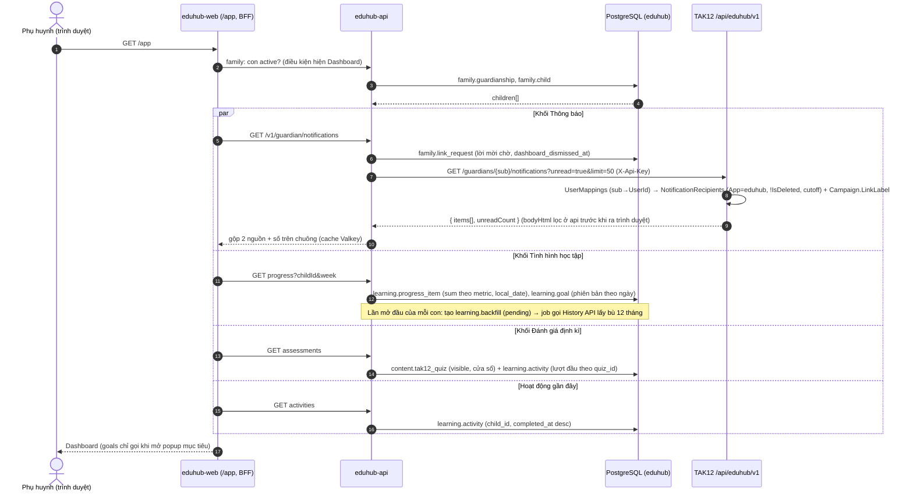
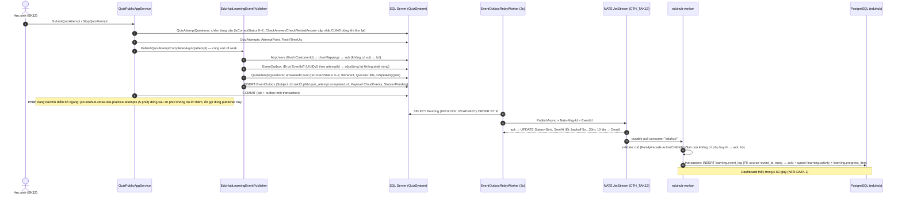
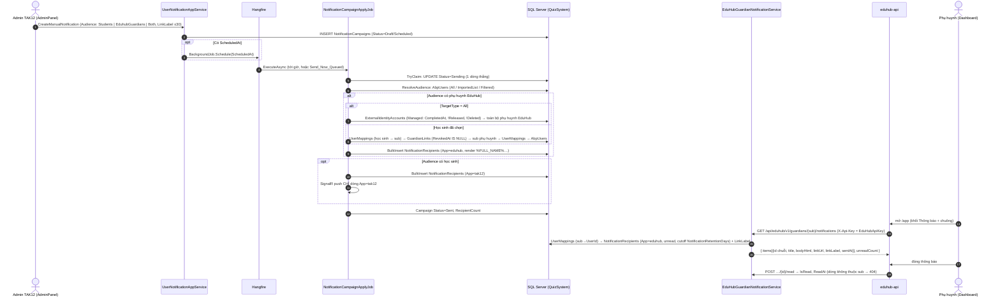

# TAK12 ⇄ EduHub: thông báo chéo và sự kiện học tập

Sơ đồ các luồng tích hợp giữa TAK12, azVocab và EduHub (spec gốc: `eduhub/docs/specs/2026-11-12-dashboard-tong-hop-phu-huynh.md`, ADR-046).

Hai kênh, hai việc khác nhau — không trộn lẫn:

| Kênh | Chở gì | Chiều |
|---|---|---|
| **HTTP API** (`/api/eduhub/v1/*`, `X-Api-Key`) | Thông báo (hộp thư TAK12, EduHub pull), tài khoản, liên kết con | EduHub ⇄ TAK12 đồng bộ |
| **EventOutbox → NATS JetStream** | Sự kiện học tập bất biến (`quiz_attempt.completed`, `word.pass_completed`, `quiz.submitted`) | TAK12/azVocab → EduHub, at-least-once |

EduHub **không có bảng thông báo** (schema `notifications` chỉ có `CREATE SCHEMA`): hộp thư và trạng thái đã đọc nằm trọn ở TAK12 (`NotificationRecipients`, phân vùng cột `App`).

## 1. Màn Dashboard của phụ huynh — tải gì, từ bảng nào

## 2. Con nộp bài trên TAK12 — publisher ghi gì, bảng nào

## 3. Chiến dịch thông báo của admin → Dashboard phụ huynh

## 4. Dòng chảy NATS JetStream — azVocab và TAK12 vào EduHub

```mermaid
flowchart LR
    subgraph AZV["azVocab (PostgreSQL)"]
        LEARN["/api/learn/update-progress<br/>so boxes cũ/mới của mỗi nghĩa từ<br/>(cùng transaction updateLearnResult)"]
        AQUIZ["Nộp quiz trực tuyến<br/>(quiz_participants)"]
        AOUT[("event_outbox<br/>id · subject · payload · status<br/>attempts · next_retry_at")]
        POLLER["poller.js (PM2, chạy liên tục)<br/>FOR UPDATE SKIP LOCKED"]
        LEARN -- "word.pass_completed.v1<br/>data: learner{sub}, entryId<br/>id = UUIDv5(userId:entryId:defId:box.id)" --> AOUT
        AQUIZ -- "quiz.submitted.v1<br/>data: learner{sub}, quizId, title,<br/>score10 = accuracy/10" --> AOUT
        AOUT --> POLLER
    end

    subgraph TAK["TAK12 (SQL Server)"]
        SUBMIT["SubmitQuizAttempt / StopQuizAttempt<br/>+ job đóng phiên treo 30 phút"]
        TOUT[("EventOutbox<br/>Subject · EventId · Payload<br/>Status · Attempts · NextRetryAt")]
        TRELAY["EventOutboxRelayWorker<br/>UPDLOCK/READPAST, backoff, Dead sau 10 lần"]
        SUBMIT -- "quiz_attempt.completed.v1<br/>data: attemptId, learner{sub}, attemptType,<br/>quizId, practiceSessionId, title, skill,<br/>durationSeconds, answeredCount, score10<br/>id = UUIDv5(tak12:type:attemptId)" --> TOUT
        TOUT --> TRELAY
    end

    subgraph NATS["NATS JetStream (account EDUHUB)"]
        SAZ[["stream CTH_AZVOCAB<br/>cth.azvocab.pNN.>"]]
        STK[["stream CTH_TAK12<br/>cth.tak12.pNN.>"]]
    end

    POLLER -- "user azvocab, Nats-Msg-Id = id<br/>pNN = FNV-1a(learnersub) mod 16" --> SAZ
    TRELAY -- "user tak12, Nats-Msg-Id = EventId" --> STK

    subgraph EH["eduhub-worker → PostgreSQL"]
        CONS["durable pull consumer eduhub<br/>(mỗi stream một consumer, ack tường minh)"]
        VAL{"validate zod<br/>+ subject khớp type"}
        DEAD[("learning.ingest_dead_letter<br/>(giữ 30 ngày, replay CLI)")]
        FAM{"activeChildIdForSub?<br/>(family.guardianship)"}
        LOG[("learning.event_log<br/>PK (source, event_id) — khử trùng")]
        RM[("learning.activity (unique child+app+source_ref)<br/>learning.progress_item (dedupe_key:<br/>quiz:id:ngày · attempt:id · word:entry:ngày)")]
        CONS --> VAL
        VAL -- "sai schema → term" --> DEAD
        VAL -- hợp lệ --> FAM
        FAM -- "không có phụ huynh → ack, bỏ" --> DROP(("bỏ"))
        FAM -- có --> LOG
        LOG -- "cùng transaction" --> RM
    end

    SAZ --> CONS
    STK --> CONS
    RM --> DASH["Dashboard /app<br/>(tình hình học tập, hoạt động gần đây)<br/>p95 ≤ 60 giây"]
```

## Ghi nhớ khi sửa

- **Thông báo**: đổi gì ở hộp thư phụ huynh thì sửa TAK12 (`NotificationRecipients.App`, `EduHubGuardianNotificationService`) — EduHub chỉ là người đọc.
- **Sự kiện học tập**: `id` phải xác định (UUIDv5) để nộp lại/lấy bù không đếm trùng; thêm trường mới vào `data` là thay đổi tương thích trong cùng major, đổi nghĩa trường là `v2`.
- Hợp đồng chuẩn: `eduhub/packages/contracts/src/learning-events.ts` (zod) — TAK12 và azVocab phát đúng schema này, lệch là vào dead letter.
