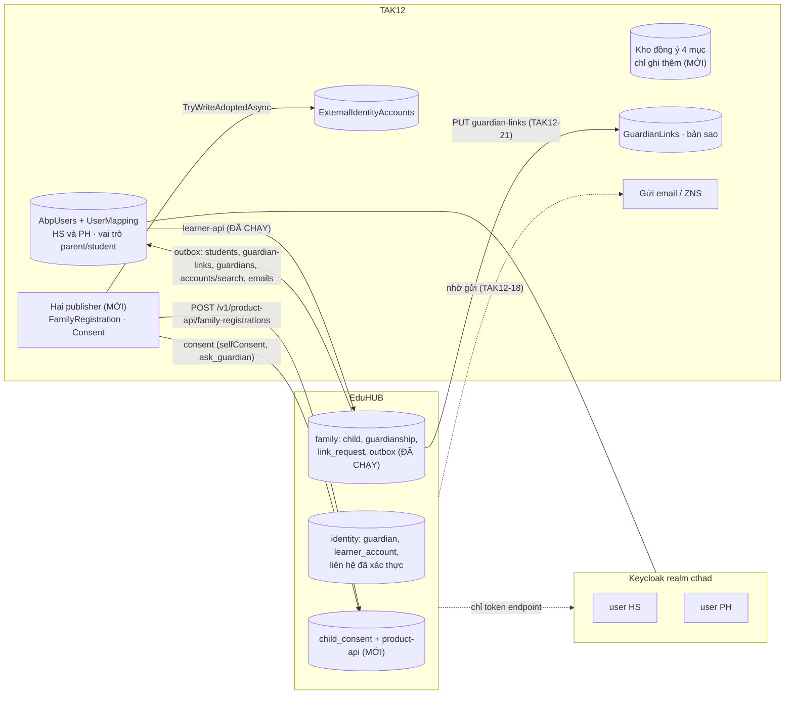
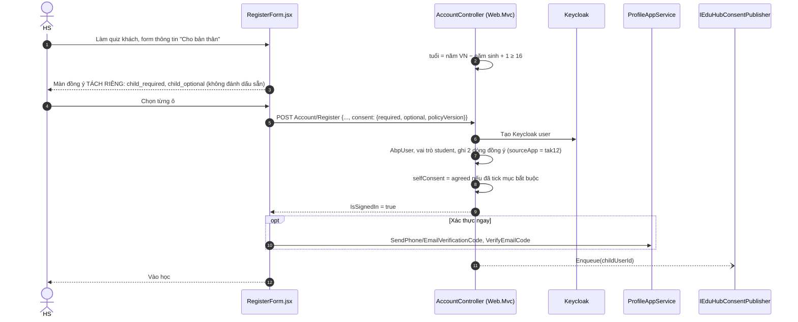
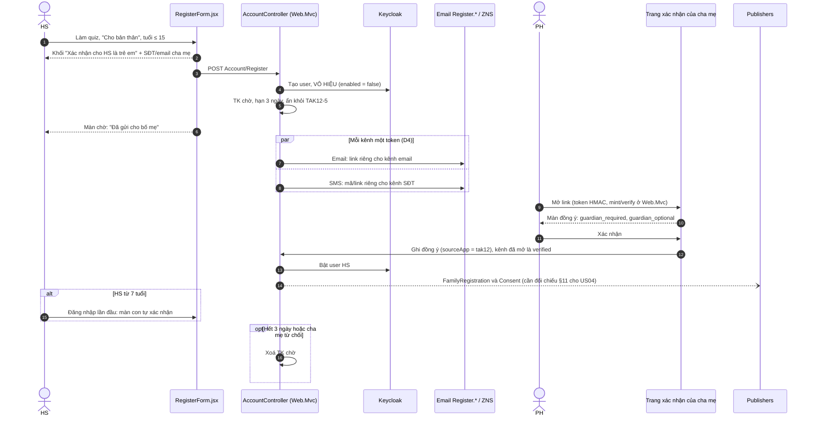
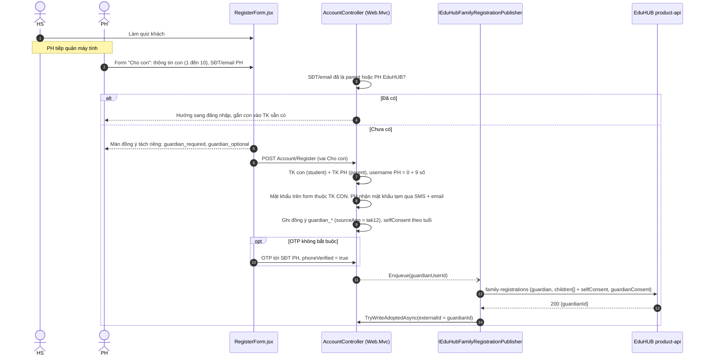
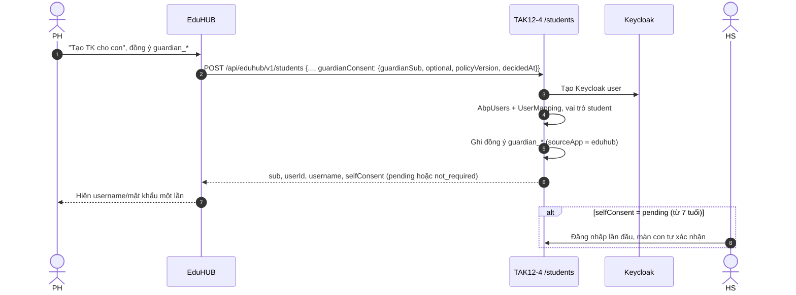
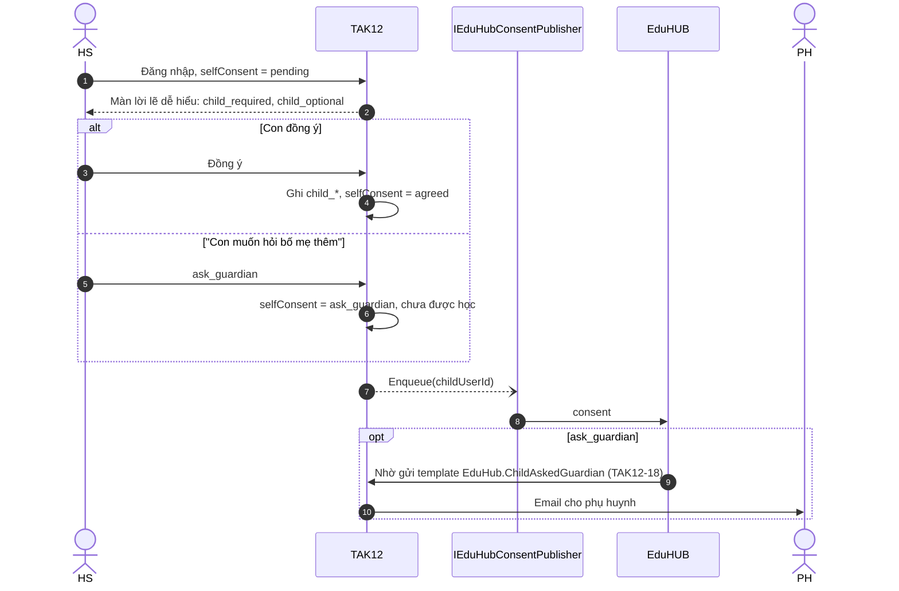
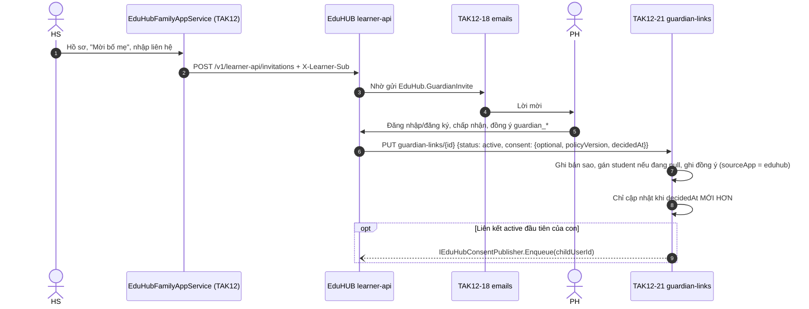

CTH-TAK12-EDUHUB 

**tuổi = năm hiện tại (giờ VN) − năm sinh + 1**. Server tự tính lại tuổi, không tin cờ do client gửi.

| Bậc | Năm sinh (năm 2026) | Cha mẹ đồng ý | Con tự xác nhận (`selfConsent`) |
| --- | --- | --- | --- |
| ≤ 6 tuổi | 2020 trở về sau | Bắt buộc | `not_required`. Vào học ngay, không hỏi con |
| 7–15 tuổi | 2012 – 2019 | Bắt buộc | `pending` → `agreed` hoặc `ask_guardian`. Màn lời lẽ dễ hiểu ở lần đăng nhập đầu |
| ≥ 16 tuổi | 2011 trở về trước | Không | `pending` → con tự quyết. Chưa xác nhận thì chưa được học |

- **Test bắt buộc**Năm 2026: người sinh 2012 là 15 tuổi (cần cha mẹ), người sinh 2011 là 16 tuổi (tự quyết). Lấy đúng ví dụ ở §11.3 làm test.
- **Hai đường POST**`RegisterForm.jsx` và `views/AgentRegister` cùng gọi `Account/Register`. Luồng Đại sứ (người lớn) rơi vào bậc ≥ 16.

| Mã mục | Ai đồng ý | Loại | Ghi khi |
| --- | --- | --- | --- |
| `guardian_required` | Cha mẹ | Bắt buộc | Luồng 2 (trang xác nhận), luồng 3 (form), luồng 4 (`sourceApp = eduhub`), TAK12-21 |
| `guardian_optional` | Cha mẹ | Tuỳ chọn | Như trên. Từ chối cũng ghi một dòng |
| `child_required` | Con, từ 7 tuổi | Bắt buộc | Màn con tự xác nhận, form tự đăng ký ≥ 16 |
| `child_optional` | Con, từ 7 tuổi | Tuỳ chọn | Như trên |

- **Mỗi dòng**`subject, code, decision, policyVersion, decidedAt, sourceApp (eduhub | tak12)`.
- **Lưu văn bản**Khuôn `ConsentTexts` (văn bản + hash SHA-256) của DocumentForms vẫn dùng được để lưu câu chữ. Nó không thay được danh mục 4 mục. Vướng tenant vẫn còn: nên tạo bảng host-level riêng.

**Đồng ý cho con có TK và học (A)**Lưu ở kho đồng ý của TAK12, gồm 4 mục. Có thể đến từ trang xác nhận của TAK12 hoặc từ EduHUB (TAK12-4, TAK12-21).

**Liên kết PH–HS**Chỉ EduHUB ghi (`family.guardianship`). `GuardianLinks` ở TAK12 là bản sao do TAK12-21 ghi. Hợp đồng này **đã chạy**.

**Vai trò parent / student (mới, R11/R14)**Mỗi `sub` phải khớp vai trò ở hai bên: guardian EduHUB tương ứng `parent`, `learner_account` tương ứng `student`. Mọi đường tạo vai trò phải báo cho bên kia. Khi vai trò lệch thì cảnh báo, không tự sửa. Đổi lại, EduHUB không phải hỏi phụ huynh “TK này đang được ai dùng?” nữa.

## Diagram

## Vòng đời TK HS

- **Chặn học**HS dưới 16 tuổi chỉ học được khi đã có đồng ý của cha mẹ. Khi con mất liên kết `active` cuối cùng có kèm đồng ý, TAK12 chặn học.
- **Con ≥ 7 vẫn tự xác nhận**Kể cả khi cha mẹ đã đồng ý trên EduHUB. Chỉ bỏ được phần đồng ý của cha mẹ, không bỏ được phần của con (X7).
- **TK cũ**Không backfill đồng ý. Riêng vai trò thì có script backfill chạy một lần (§10.4).

## HS tự đăng ký, từ 16 tuổi

- **Chưa tick mục bắt buộc**TK vẫn được tạo nhưng `selfConsent = pending`: chưa được học, lần đăng nhập sau sẽ hỏi lại.
- **Keycloak lỗi**Nếu `IsSignedIn=false` thì bỏ qua bước OTP và rơi về banner nhắc.

## HS tự đăng ký, từ 15 tuổi trở xuống (US04)

- **X6 · Xác thực theo kênh**`phoneVerified`/`emailVerified` chỉ là `true` khi đúng kênh đó được xác thực. Một link dùng chung cho cả hai kênh thì cả hai đều là `false`. Gửi mã cho cha mẹ rồi để HS nhập hộ thì SĐT đó cũng **không** được tính là đã xác thực.
- **Giữ nguyên từ kế hoạch**Token dạng HMAC + hạn + base64url, so sánh bằng `FixedTimeEquals`. Không truyền `?id=` trần. Trang theo khuôn `ActiveAccount`. Không dùng `EduHubControllerBase`.
- **Nếu D1 giữ “dùng bình thường”**Phải đưa lại pháp chế và sửa CR-DK-01 §1. Phương án thứ ba: tách “chờ xác thực” (bị chặn) khỏi “đã xác thực nhưng chưa hoàn tất hồ sơ” (không chặn). Phương án này phải được viết thành thiết kế riêng.
- **Nút «Vào EduHUB»**Mở `{PUBLIC_APP_URL}/#dang-nhap`. Không tự đặt ra đường dẫn khác.

## PH điền form “Cho con” trên TAK12

- **Tách mật khẩu**Nếu dùng chung một mật khẩu, con vào được TK của cha mẹ, đổi lựa chọn dữ liệu và gỡ liên kết.
- **Job bền**Tham số job **chỉ là ID người dùng**. Payload được dựng lúc job chạy. Thử lại với backoff, tối đa 24 giờ. Enqueue lại khi PH xác thực SĐT/email sau lần đẩy đầu.
- **Con từ 7 tuổi**Vẫn phải qua màn tự xác nhận ở lần đăng nhập đầu.

## PH tạo TK cho con từ EduHUB (TAK12-4)

## Màn con tự xác nhận

- **Khi nào enqueue**Khi con chọn trên màn này, khi TAK12 xác định con cần tự xác nhận, và khi TAK12-21 tạo dòng `GuardianLinks` `active` **đầu tiên** của con.

## Liên kết PH–HS

- **Quy tắc**Chỉ EduHUB ghi quan hệ (spec 02/11 R7). TAK12 không tự ghi `GuardianLinks`.
- **revoked**Nếu con dưới 16 tuổi không còn liên kết `active` nào kèm đồng ý, TAK12 chặn học.
