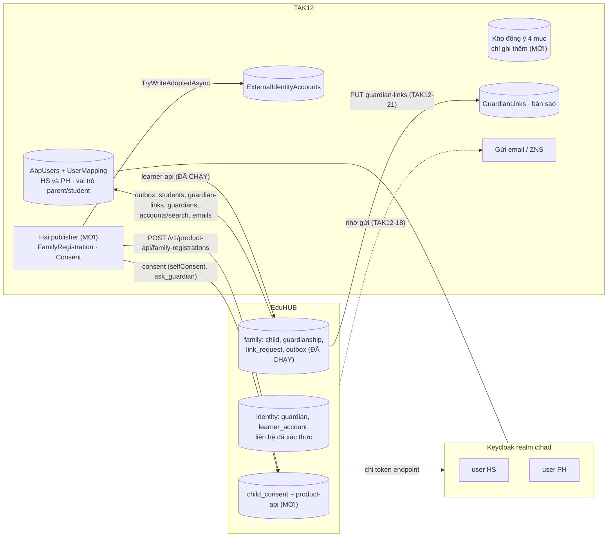
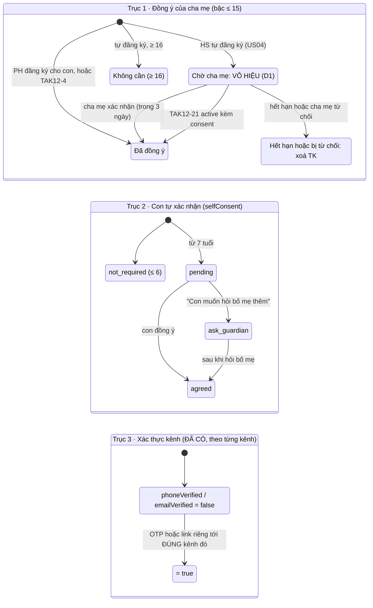
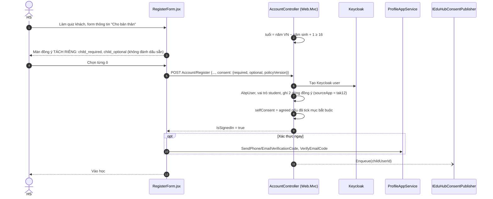
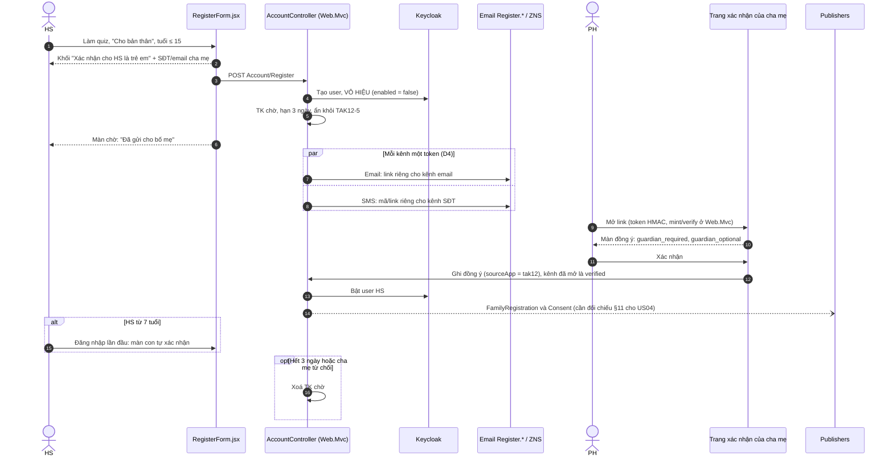
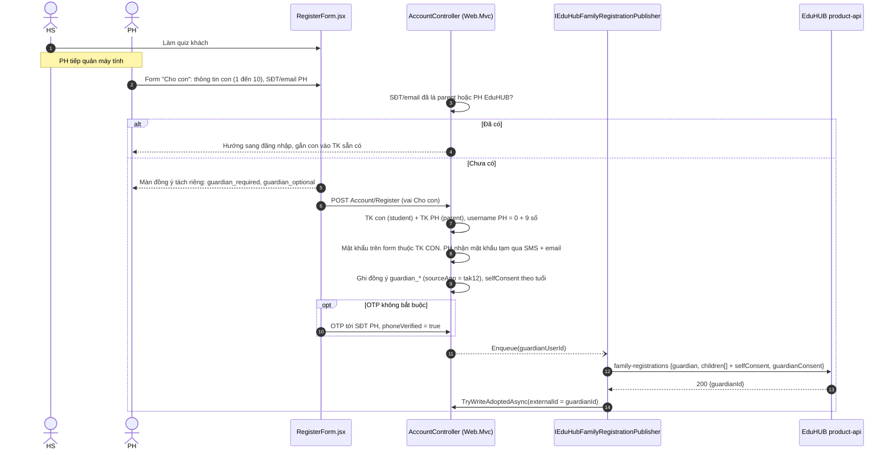
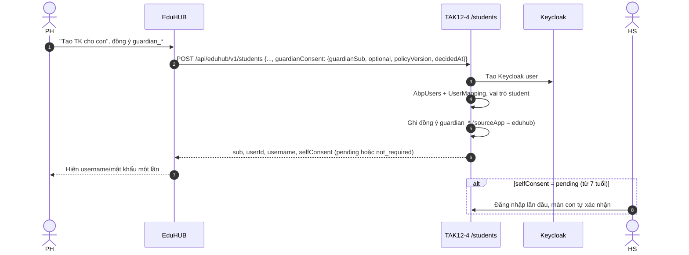
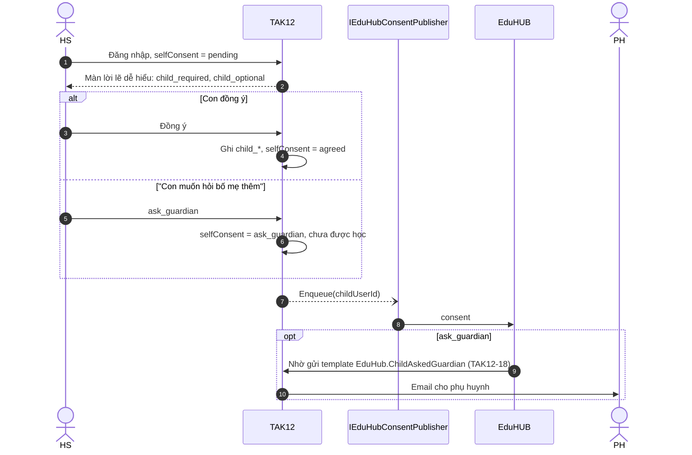
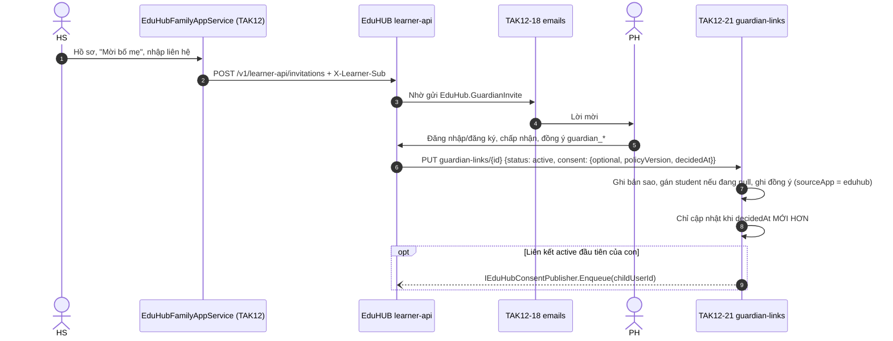

CTH-TAK12-EDUHUB · ĐIỀU KHOẢN MỚI · BẢN 4 · NỀN CR-DK-01 §11 (EDUHUB d2c369d, 11/11/2026)

# Luồng đăng ký & liên kết tài khoản TAK12 – EduHUB

PO chốt CR-DK-01 ngày 10/11/2026. Đây là thiết kế chung cho cả hai hệ thống, để tuân thủ Luật BVDLCN 91/2025/QH15, NĐ 356/2025 và NĐ 330/2026. Spec `2026-11-10-dong-y-xu-ly-du-lieu-ca-nhan-cr-dk-01.md` đã đặc tả sẵn phần việc của TAK12 ở §11.1–§11.3. Kế hoạch này được viết lại trên nền đó, thay hoàn toàn bản 3.

**A** Đồng ý xử lý dữ liệu, gồm 4 mục **PH** Phụ huynh**HS** Học sinh**TK** Tài khoản Đã chạy có mã, chạy hai chiều Mới mới có spec, cả hai đội cùng làm Chờ chốt quyết định còn mở

[Kết luận](#ket-luan)[Luật tuổi](#tuoi)[Danh mục đồng ý](#dong-y)[Trách nhiệm dữ liệu](#tong-quan)[Vòng đời TK](#vong-doi) [1 · Tự đăng ký ≥16](#luong-1)[2 · Tự đăng ký ≤15 (US04)](#luong-2)[3 · PH “Cho con”](#luong-3) [4 · Từ EduHUB](#luong-4)[Con tự xác nhận](#tu-xac-nhan)[B · Liên kết](#luong-b) [Xung đột X1–X8](#xung-dot)[Thiết kế kỹ thuật](#ky-thuat)[Quyết định D1–D6](#quyet-dinh)[Giai đoạn](#giai-doan)

**Kết luận**

**Hợp đồng liên kết PH–HS (spec 02/11, ADR-043) đã chạy được hai chiều.** Module `family` có 4 migration, có `learner-api` đúng đường dẫn TAK12 đang gọi, có outbox gửi sang TAK12 và có `canAccessChild`. Các kết luận “EduHUB chưa có gì” của bản 3 không còn đúng.

**Hợp đồng đồng ý (CR-DK-01) mới có spec, chưa có mã ở cả hai bên.** Kế hoạch TAK12 nhắm vào phần này. Bốn luồng đăng ký trong kế hoạch tương ứng với US03, US04, US05 của CR-DK-01, và các US này đều đã có hợp đồng.

**Có một chỗ chặn:** kế hoạch TAK12 đã chốt “TK chờ vẫn dùng bình thường”, còn CR-DK-01 yêu cầu **vô hiệu TK chờ** cho tới khi cha mẹ duyệt (X1). PO và pháp chế phải chọn một trong hai (D1).

1

## Luật tuổi: ba bậc, công thức +1

Mới

Chủ dự án chốt ngày 10/11/2026 (CR-DK-01 §11.3): **tuổi = năm hiện tại (giờ VN) − năm sinh + 1**. Ngưỡng 15 giữ nguyên. Nếu cài theo kiểu `currentYear − birthYear <= 15` thì sẽ chặn sai đúng một lứa sinh (X2). Luật này là hằng số trong Core và có bản gương ở `gradeAge.js`. Server tự tính lại tuổi, không tin cờ do client gửi.

| Bậc | Năm sinh (năm 2026) | Cha mẹ đồng ý | Con tự xác nhận (`selfConsent`) |
| --- | --- | --- | --- |
| ≤ 6 tuổi | 2020 trở về sau | Bắt buộc | `not_required`. Vào học ngay, không hỏi con |
| 7–15 tuổi | 2012 – 2019 | Bắt buộc | `pending` → `agreed` hoặc `ask_guardian`. Màn lời lẽ dễ hiểu ở lần đăng nhập đầu |
| ≥ 16 tuổi | 2011 trở về trước | Không | `pending` → con tự quyết. Chưa xác nhận thì chưa được học |

- **Test bắt buộc**Năm 2026: người sinh 2012 là 15 tuổi (cần cha mẹ), người sinh 2011 là 16 tuổi (tự quyết). Lấy đúng ví dụ ở §11.3 làm test.
- **Hai đường POST**`RegisterForm.jsx` và `views/AgentRegister` cùng gọi `Account/Register`. Luồng Đại sứ (người lớn) rơi vào bậc ≥ 16.

2

## Danh mục đồng ý: 4 mục, chỉ ghi thêm

Mới

Một ô tick `AgreedToTerms` là không đủ (X4). Màn đồng ý phải **tách khỏi form thông tin**, gồm hai ô **không đánh dấu sẵn**: một bắt buộc, một tuỳ chọn. Mỗi quyết định ghi thành một dòng, **kể cả khi từ chối**. Bảng chỉ ghi thêm, không sửa dòng cũ. Bốn mã mục là hợp đồng với EduHUB. Câu chữ thì mỗi bên giữ bản riêng, nhưng mục đích phải khớp nhau (D5).

| Mã mục | Ai đồng ý | Loại | Ghi khi |
| --- | --- | --- | --- |
| `guardian_required` | Cha mẹ | Bắt buộc | Luồng 2 (trang xác nhận), luồng 3 (form), luồng 4 (`sourceApp = eduhub`), TAK12-21 |
| `guardian_optional` | Cha mẹ | Tuỳ chọn | Như trên. Từ chối cũng ghi một dòng |
| `child_required` | Con, từ 7 tuổi | Bắt buộc | Màn con tự xác nhận, form tự đăng ký ≥ 16 |
| `child_optional` | Con, từ 7 tuổi | Tuỳ chọn | Như trên |

- **Mỗi dòng**`subject, code, decision, policyVersion, decidedAt, sourceApp (eduhub | tak12)`.
- **Lưu văn bản**Khuôn `ConsentTexts` (văn bản + hash SHA-256) của DocumentForms vẫn dùng được để lưu câu chữ. Nó không thay được danh mục 4 mục. Vướng tenant vẫn còn: nên tạo bảng host-level riêng.

**Đồng ý cho con có TK và học (A)**Lưu ở kho đồng ý của TAK12, gồm 4 mục. Có thể đến từ trang xác nhận của TAK12 hoặc từ EduHUB (TAK12-4, TAK12-21).

**Liên kết PH–HS**Chỉ EduHUB ghi (`family.guardianship`). `GuardianLinks` ở TAK12 là bản sao do TAK12-21 ghi. Hợp đồng này **đã chạy**.

**Vai trò parent / student (mới, R11/R14)**Mỗi `sub` phải khớp vai trò ở hai bên: guardian EduHUB tương ứng `parent`, `learner_account` tương ứng `student`. Mọi đường tạo vai trò phải báo cho bên kia. Khi vai trò lệch thì cảnh báo, không tự sửa. Đổi lại, EduHUB không phải hỏi phụ huynh “TK này đang được ai dùng?” nữa.

3

## Bản đồ trách nhiệm dữ liệu

EduHUB đã gọi TAK12 qua đủ các endpoint. TAK12 gọi EduHUB qua `learner-api` (đã chạy). TAK12 sẽ gọi thêm `product-api` (mới, CR-DK-01) qua hai publisher.

4

## Vòng đời TK HS: ba trục

Mới

Hai trục mới đều **không đụng** `VerificationRequirement` và `IsVerified`. Kế hoạch đã đúng ở điểm này và giữ nguyên. Theo CR-DK-01, TK chờ cha mẹ duyệt **bị vô hiệu**, nhưng điểm này còn chờ D1.

- **Chặn học**HS dưới 16 tuổi chỉ học được khi đã có đồng ý của cha mẹ. Khi con mất liên kết `active` cuối cùng có kèm đồng ý, TAK12 chặn học.
- **Con ≥ 7 vẫn tự xác nhận**Kể cả khi cha mẹ đã đồng ý trên EduHUB. Chỉ bỏ được phần đồng ý của cha mẹ, không bỏ được phần của con (X7).
- **TK cũ**Không backfill đồng ý. Riêng vai trò thì có script backfill chạy một lần (§10.4).

1

## HS tự đăng ký, từ 16 tuổi

Mới

Con tự quyết, nhưng **chưa xác nhận thì chưa được học**. Đây không còn là luồng “không cần gì” như kế hoạch cũ. OTP vẫn không bắt buộc và tái dùng `ProfileAppService` sau khi `Account/Register` tự đăng nhập. Không mở endpoint OTP ẩn danh.

- **Chưa tick mục bắt buộc**TK vẫn được tạo nhưng `selfConsent = pending`: chưa được học, lần đăng nhập sau sẽ hỏi lại.
- **Keycloak lỗi**Nếu `IsSignedIn=false` thì bỏ qua bước OTP và rơi về banner nhắc.

2

## HS tự đăng ký, từ 15 tuổi trở xuống (US04)

Chờ D1

Sơ đồ dưới đây vẽ theo CR-DK-01 §11.3. **TK chờ không được TAK12-5 trả về, không đăng nhập được EduHUB hay azVocab, không gọi được `learner-api`. User Keycloak bị vô hiệu cho tới khi cha mẹ duyệt.** Lý do: nếu TK chờ lọt ra ngoài, gợi ý liên kết theo SĐT cha mẹ (L2) có thể liên kết với đúng TK chờ đó. Sau đó, nếu cha mẹ từ chối hoặc hết hạn và TAK12 xoá TK, EduHUB còn sót lại hồ sơ con không có chủ.

- **X6 · Xác thực theo kênh**`phoneVerified`/`emailVerified` chỉ là `true` khi đúng kênh đó được xác thực. Một link dùng chung cho cả hai kênh thì cả hai đều là `false`. Gửi mã cho cha mẹ rồi để HS nhập hộ thì SĐT đó cũng **không** được tính là đã xác thực.
- **Giữ nguyên từ kế hoạch**Token dạng HMAC + hạn + base64url, so sánh bằng `FixedTimeEquals`. Không truyền `?id=` trần. Trang theo khuôn `ActiveAccount`. Không dùng `EduHubControllerBase`.
- **Nếu D1 giữ “dùng bình thường”**Phải đưa lại pháp chế và sửa CR-DK-01 §1. Phương án thứ ba: tách “chờ xác thực” (bị chặn) khỏi “đã xác thực nhưng chưa hoàn tất hồ sơ” (không chặn). Phương án này phải được viết thành thiết kế riêng.
- **Nút «Vào EduHUB»**Mở `{PUBLIC_APP_URL}/#dang-nhap`. Không tự đặt ra đường dẫn khác.

3

## PH điền form “Cho con” trên TAK12

Mới

Đây không còn là việc nội bộ của TAK12 (X5). TAK12 **đẩy ngay** sang `POST /v1/product-api/family-registrations` (khoá `tak12`, scope `eduhub:family.register`, chỉ nhận từ IP server TAK12). EduHUB trả về `{ guardianId }`, sau đó TAK12 ghi dòng đánh dấu qua `TryWriteAdoptedAsync`, cùng đường với TAK12-19.

- **Tách mật khẩu**Nếu dùng chung một mật khẩu, con vào được TK của cha mẹ, đổi lựa chọn dữ liệu và gỡ liên kết.
- **Job bền**Tham số job **chỉ là ID người dùng**. Payload được dựng lúc job chạy. Thử lại với backoff, tối đa 24 giờ. Enqueue lại khi PH xác thực SĐT/email sau lần đẩy đầu.
- **Con từ 7 tuổi**Vẫn phải qua màn tự xác nhận ở lần đăng nhập đầu.

4

## PH tạo TK cho con từ EduHUB (TAK12-4)

Đã chạyĐổi hợp đồng

Luồng này đã chạy hai chiều. CR-DK-01 đổi hợp đồng (X7): `POST /students` **bắt buộc** nhận `guardianConsent`, và response trả thêm `selfConsent`. Đề nghị “Y1: đặt `Verified` ngay” của bản 3 bị thay: con từ 7 tuổi vẫn phải tự xác nhận.

5

## Màn con tự xác nhận

Mới

Kế hoạch cũ thiếu hẳn bước này (X3). Màn hiện ở lần đăng nhập đầu cho mọi HS từ 7 tuổi có `selfConsent = pending`, bất kể TK được tạo theo luồng nào. Lời lẽ trên màn phải dễ hiểu với trẻ.

- **Khi nào enqueue**Khi con chọn trên màn này, khi TAK12 xác định con cần tự xác nhận, và khi TAK12-21 tạo dòng `GuardianLinks` `active` **đầu tiên** của con.

B

## Liên kết PH–HS

Đã chạyTAK12-21 đổi

Hai lo ngại của bản 3 đã hết. EduHUB đã cài `learner-api` đúng bộ đường dẫn TAK12 đang gọi: `GET links`, `POST link-requests/:id/accept|decline`, `POST invitations`, `POST invitations/:id/cancel`, `DELETE guardianships/:id`. EduHUB cũng đã gọi `PUT guardian-links/{id}` qua outbox. Phần TAK12 cần sửa là body của TAK12-21.

- **Quy tắc**Chỉ EduHUB ghi quan hệ (spec 02/11 R7). TAK12 không tự ghi `GuardianLinks`.
- **revoked**Nếu con dưới 16 tuổi không còn liên kết `active` nào kèm đồng ý, TAK12 chặn học.

X

## Tám xung đột giữa kế hoạch cũ và CR-DK-01

| # | Kế hoạch cũ | CR-DK-01 | Mức |
| --- | --- | --- | --- |
| X1 | TK chờ dùng bình thường, chỉ nhắc | Vô hiệu tới khi cha mẹ duyệt (§1, §11.3) | Chặn · D1 |
| X2 | `GuardianRequiredMaxAge = 15`, không ghi công thức | tuổi = năm VN − năm sinh + 1 | Lệch một lứa · D2 |
| X3 | Hai bậc: cần / không cần cha mẹ | Ba bậc, có `selfConsent` | Thiếu hẳn |
| X4 | Một ô tick `AgreedToTerms` | 4 mục, hai ô tách riêng, ghi cả khi từ chối | Thiếu · D3 |
| X5 | Luồng 3 là việc nội bộ | Đẩy `family-registrations`, tách mật khẩu, không tạo PH thứ hai | Thiếu |
| X6 | Một link/mã chung cho cha mẹ | Mỗi kênh một token | D4 |
| X7 | Y1: TK từ `/students` là Verified ngay | `guardianConsent` bắt buộc, con ≥ 7 vẫn tự xác nhận | Đổi hợp đồng |
| X8 | Không có vai trò | `parent`/`student` hai chiều, TAK12-23, backfill | Thiếu |

### Phần kế hoạch vẫn đúng, giữ nguyên

- **9.1**Tách đồng ý của người giám hộ khỏi `VerificationRequirement`/`IsVerified`.
- **9.2**Luật tuổi là hằng số trong Core. Server tự tính tuổi. Chỉ sửa công thức.
- **9.4**Tái dùng OTP của `ProfileAppService`, không mở endpoint OTP ẩn danh.
- **9.5**Khuôn token HMAC, trang theo khuôn `ActiveAccount`, template prefix `Register.`, ZNS gửi mã 6 số. Bổ sung: mỗi kênh một token.
- **9.6**Xác thực TK trẻ em khác với liên kết PH–HS. Chỉ EduHUB ghi quan hệ.
- **9.7 – 9.8**SQL script idempotent, không thêm `Migrations/*.cs`. Sửa form ở một component dùng chung. Kiểm lại `AgentRegister`.

T

## Thiết kế kỹ thuật phía TAK12

### Dữ liệu mới (tên đề xuất)

| Thành phần | Nội dung | Ghi chú |
| --- | --- | --- |
| Vai trò trên AbpUsers | `parent \| student \| null` | Gán ở mọi đường tạo TK. Lệch với EduHUB thì cảnh báo. |
| Kho đồng ý (bảng mới) | `SubjectUserId, Code, Decision, PolicyVersion, DecidedAt, SourceApp, ConsentTextId` | Chỉ ghi thêm. 4 mã mục. Có dòng ghi cả quyết định từ chối. |
| Câu chữ đồng ý | Bảng host-level, khuôn `ConsentTexts` | Hash SHA-256 câu chữ đã chuẩn hoá. |
| Trạng thái cha mẹ | `GuardianConsentStatus`, hạn 3 ngày | Trạng thái chờ đi kèm vô hiệu Keycloak (tuỳ D1). |
| `SelfConsentStatus` | `not_required \| pending \| agreed \| ask_guardian` | Trả về trong TAK12-4, đẩy sang EduHUB. |
| Liên hệ cha mẹ | `ParentPhoneNumber` + cờ verified theo từng kênh | `ParentEmail` đã có sẵn. |

### API TAK12 phải sửa hoặc thêm (EduHUB gọi)

| Mã | Việc |
| --- | --- |
| TAK12-4 `POST /students` | Nhận `guardianConsent` (bắt buộc). Ghi kho đồng ý với `sourceApp = eduhub`. Gán vai trò `student`. Trả thêm `selfConsent`. |
| TAK12-5 `accounts/search` | Mỗi kết quả thêm `role`. Không trả TK chờ. |
| TAK12-16, TAK12-19 `guardians`, `adopt` | Gán vai trò `parent`. TK đang là `student` thì trả `409 account_is_student`. |
| TAK12-21 `PUT guardian-links/{id}` | Body thêm `consent` (bắt buộc khi `active`). Gán `student` nếu đang `null`. Chỉ cập nhật khi `decidedAt` mới hơn. |
| TAK12-23 (mới) | `PUT /api/eduhub/v1/accounts/{sub}/role {role: student}`. Tạo `AbpUsers` trước nếu TK mới chỉ có ở Keycloak. TK đang `parent` thì trả `409 role_conflict`. |
| TAK12-18 | Thêm template `EduHub.ChildAskedGuardian`. |
| Backfill | Script gán vai trò, chạy một lần (§10.4). |

### TAK12 gọi EduHUB (mới)

| Publisher | Gọi khi | Chi tiết |
| --- | --- | --- |
| `IEduHubFamilyRegistrationPublisher` | Vừa tạo xong cặp TK PH–con. PH xác thực SĐT/email sau lần đẩy đầu. | Job chỉ nhận ID, dựng payload lúc chạy, backoff tối đa 24 giờ. `200` thì ghi `TryWriteAdoptedAsync`. |
| `IEduHubConsentPublisher` | Con chọn trên màn tự xác nhận. Con được xác định cần tự xác nhận. Liên kết `active` đầu tiên. | Mang `selfConsent`. Trường hợp `ask_guardian` thì EduHUB gửi email cho PH. |

### Việc TAK12 tự quyết (EduHUB không phụ thuộc)

- **Màn hình**Form tách màn đồng ý, màn chờ, trang xác nhận của cha mẹ, màn con tự xác nhận.
- **Đăng nhập ngoài**Google/Facebook. `email_verified` của nhà cung cấp được tính là xác thực kênh email.
- **Hạn**Cha mẹ có 3 ngày để xác thực. Phải quy định việc gì xảy ra khi hết hạn.
- **Chặn học**Con dưới 16 tuổi không còn liên kết `active` nào kèm đồng ý thì bị chặn học.

D

## Quyết định phải chốt trước khi viết mã

| Mã | Nội dung | Ai chốt | Chặn việc gì |
| --- | --- | --- | --- |
| D1 | TK chờ ở luồng 2 (US04): **vô hiệu** theo CR-DK-01 hay **dùng bình thường** theo kế hoạch cũ? Không thể làm cả hai. | PO + pháp chế | Toàn bộ luồng 2, quy tắc ẩn TK chờ ở TAK12-5 |
| D2 | Công thức tuổi `+1` và ba bậc ≤ 6 / 7–15 / ≥ 16 | Tech lead hai đội | Mọi nhánh rẽ theo tuổi |
| D3 | Hình dạng kho đồng ý: 4 mã, `optional`, `sourceApp`, chỉ ghi thêm | Tech lead TAK12 | TAK12-4, TAK12-21, hai publisher |
| D4 | Một hay hai token cho link xác thực cha mẹ | Tech lead TAK12 | Chất lượng liên hệ PH ở EduHUB |
| D5 | Câu chữ 4 mục ở TAK12 khớp mục đích với bản EduHUB | PO | Màn đăng ký của cả hai bên |
| D6 | Viết ADR-045 (phụ huynh do TAK12 đẩy sang được nhận dù liên hệ chưa xác thực) | Tech lead EduHUB | `pnpm verify` của EduHUB |

R

## Thứ tự triển khai (khớp CR-DK-01 §17)

Nguyên tắc đã chốt: **EduHUB lên trước, TAK12 lên sau, không có công tắc riêng**. TAK12 bản cũ bỏ qua các trường mới. Nếu EduHUB thiếu `role`/`selfConsent` thì rơi về hành vi hiện nay.

| GĐ | Nội dung TAK12 | Phụ thuộc |
| --- | --- | --- |
| 0 | Chốt D1–D5 với đội EduHUB. Tài liệu repo viết theo CR-DK-01 §11 | — |
| 1 | Nền trong TAK12: vai trò `parent`/`student`, kho đồng ý 4 mục, luật tuổi (+1, ba bậc), màn con tự xác nhận, seed template `EduHub.ChildAskedGuardian` | D1–D3 |
| 2 | Luồng đăng ký mới (US03, US04, US05): form tách màn đồng ý, OTP không bắt buộc, màn chờ, trang xác nhận của cha mẹ (mỗi kênh một token), Google/Facebook, tách mật khẩu PH, không tạo PH thứ hai | GĐ 1, D4 |
| 3 | Hai publisher gọi EduHUB và ghi dòng đánh dấu qua `TryWriteAdoptedAsync` | GĐ 2. EduHUB đã deploy `product-api` |
| 4 | Sửa API cho EduHUB gọi: TAK12-4, TAK12-5, TAK12-16/19, TAK12-21, TAK12-23, backfill vai trò | GĐ 1 |
| 5 | **Bật luồng đăng ký mới** | Sau khi EduHUB chạy `family:resync-tak12` |

### Thứ tự deploy

1. EduHUB: migration, nginx `product-api`, allowlist IP của TAK12.
2. TAK12: seed template, API mới, backfill vai trò.
3. EduHUB: chạy `pnpm --filter @eduhub/api family:resync-tak12`.
4. TAK12: bật luồng đăng ký mới.
