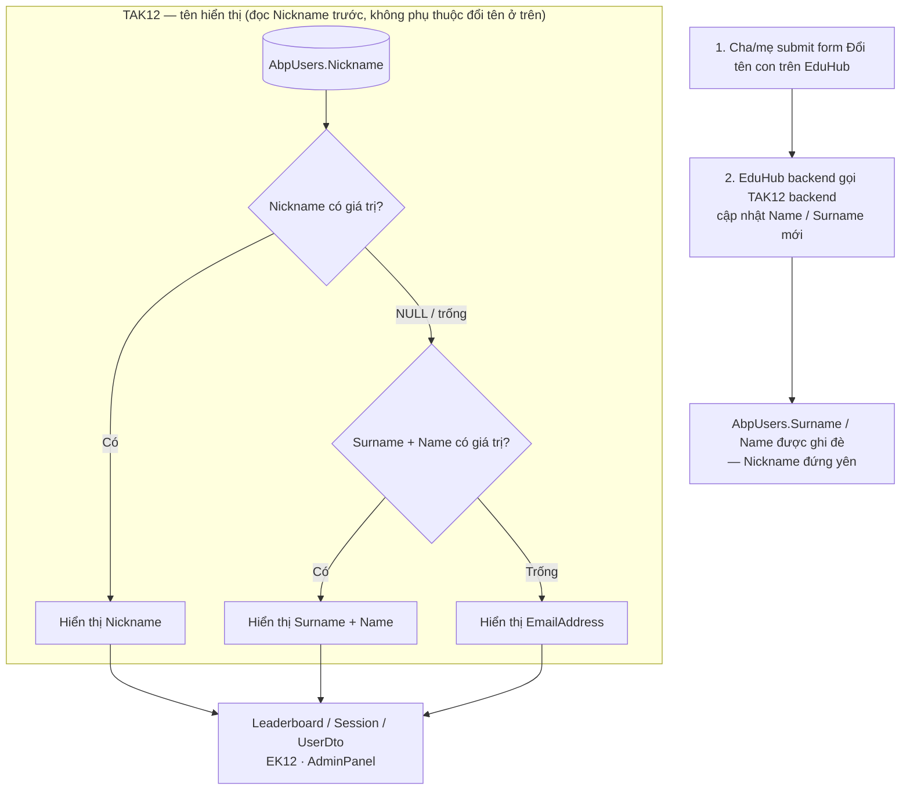
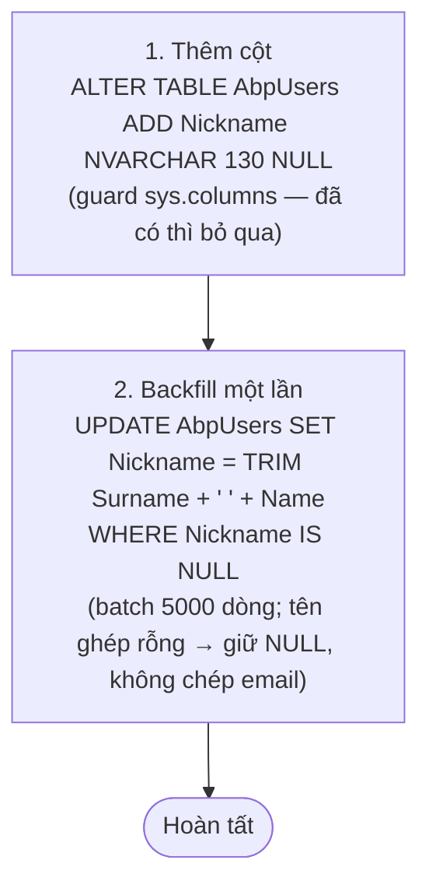

# User Nickname — thiết kế & migration

**Ngày:** 2026-11-25
**Phạm vi:** TAK12 (`CTH.QuizSystem`); AzVocab sẽ làm tương tự sau.
**Mục tiêu (EduHub):** Cha/mẹ có thể đặt/đổi tên cho con trên EduHub mà **không** làm đổi tên hiển thị của con trên TAK12 (và sau này AzVocab).

## Vấn đề

`AbpUsers.Surname` / `AbpUsers.Name` giờ đồng bộ từ **Keycloak**. Khi cha/mẹ đổi tên con trên EduHub, Keycloak ghi đè hai cột này — tên con tự thấy trên TAK12 (leaderboard, header, profile) cũng đổi theo. Cần một cột tên hiển thị **riêng của TAK12**, tách khỏi vòng đồng bộ Keycloak.

## Giải pháp

Thêm cột `AbpUsers.Nickname NVARCHAR(130) NULL`:

- **Backfill một lần** = `Surname + ' ' + Name` (trim) → tên hiển thị hiện tại được "đóng băng" tại thời điểm migration.
- Tài khoản không có họ tên: để `NULL`, **không** chép `EmailAddress` vào (tránh nhân đôi PII); hiển thị rơi về `FullName` (→ email) ở tầng ứng dụng.
- `130 = 64 (Surname) + 1 (space) + 64 (Name) + 1 dư`.
- Hiển thị: ưu tiên `Nickname`, trống thì `FullName` như cũ (`User.DisplayName`, `GetDisplayName(...)` trong `AnalyzeAppService`).

## Luồng tổng thể



## Luồng migration (script idempotent)

Chạy **một lần** (script vẫn idempotent — lỡ chạy lại chỉ đụng dòng còn NULL, không ghi đè nickname đã đặt):



## Các bước triển khai

| # | Bước | Chi tiết |
|---|------|----------|
| 1 | Deploy code | Entity `User.Nickname` + `DisplayName`, snapshot sửa tay, DTO (`UserDto`, `UserLoginInfoDto`), `AnalyzeAppService` leaderboard. Code chịu được cột chưa tồn tại? **Không** — EF select `Nickname` ngay, nên **chạy SQL trước hoặc cùng đợt deploy** (Migrator chạy script trước khi app mới nhận traffic). |
| 2 | Chạy script SQL | `Migrations/Scripts/20261125_AbpUsers_AddNickname.sql` qua quy trình Migrator hiện có (idempotent, chạy lại vô hại). |
| 3 | Kiểm tra sau migration | Xem mục *Kiểm tra* bên dưới. |
| 4 | Cache | Không cần flush: bản ghi `leaderboardRawCache` cũ (10 phút) thiếu `Nickname` → deserialize `null` → fallback về Surname+Name như trước. |
| 5 | Frontend (việc sau) | EK12 / AdminPanel đổi render sang `nickname \|\| surname + name` — field đã có trong payload `GetCurrentLoginInformations`. |
| 6 | EduHub ghi nickname (việc sau) | Thêm app-service cho EduHub đặt/đổi `Nickname` của con. |
| 7 | AzVocab (việc sau) | Lặp lại pattern: cột `Nickname` + backfill + display fallback. |

## Kiểm tra sau migration

```sql
-- Cột đã có
SELECT 1 FROM sys.columns
WHERE object_id = OBJECT_ID('dbo.AbpUsers') AND name = 'Nickname';

-- Dòng còn NULL = chỉ những tài khoản không có họ tên (hiển thị rơi về email)
SELECT COUNT(*) AS NullNicknames
FROM dbo.AbpUsers
WHERE Nickname IS NULL
  AND NULLIF(LTRIM(RTRIM(CONCAT(ISNULL(Surname,''), ' ', ISNULL(Name,'')))), '') IS NOT NULL;
-- Kỳ vọng: 0

-- Mẫu đối chiếu
SELECT TOP 20 Id, Surname, Name, Nickname, EmailAddress
FROM dbo.AbpUsers ORDER BY Id DESC;
```

Trên app: đăng nhập → `GET /api/services/app/Session/GetCurrentLoginInformations` có field `nickname`; leaderboard hiển thị tên như trước migration.

## Điểm thiết kế cần nhớ

- **Không bao giờ** backfill lại hàng loạt sau khi người dùng đã tự đặt nickname — script chỉ đụng dòng `Nickname IS NULL` chính là vì vậy.
- Đổi tên trên Keycloak/EduHub sau migration chỉ đổi `Surname/Name`; `Nickname` đứng yên — đó là hành vi mong muốn.
- Schema thay đổi bằng **SQL script idempotent**, không thêm EF `Migrations/*.cs`; entity + `QuizSystemDbContextModelSnapshot.cs` sửa tay cùng đợt (quy tắc repo).
