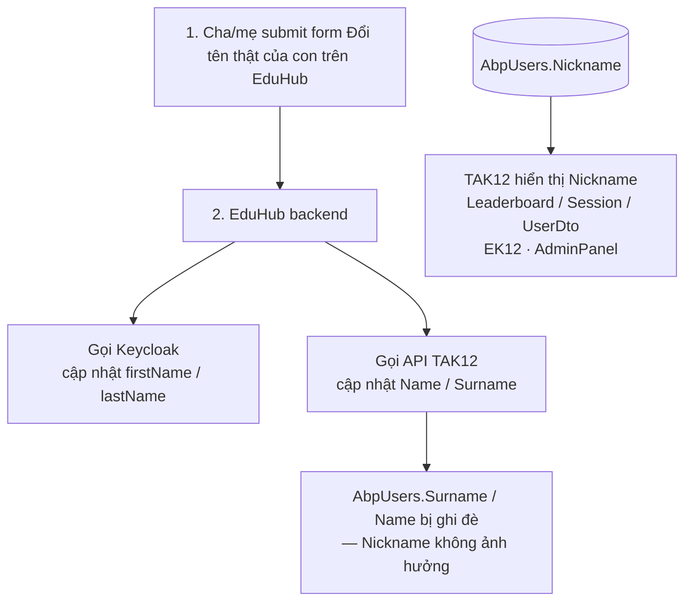

# User Nickname — thiết kế & migration

**Ngày:** 2026-11-25
**Phạm vi:** TAK12 (`CTH.QuizSystem`); AzVocab sẽ làm tương tự sau.
**Mục tiêu (EduHub):** Cha/mẹ có thể đặt/đổi tên cho con trên EduHub mà **không** làm đổi tên hiển thị của con trên TAK12 (và sau này AzVocab).

Thêm cột `AbpUsers.Nickname NVARCHAR(130) NULL`:

## Luồng tổng thể

## Luồng migration (script idempotent)

Chạy **một lần** (script vẫn idempotent — lỡ chạy lại chỉ đụng dòng còn NULL, không ghi đè nickname đã đặt):

